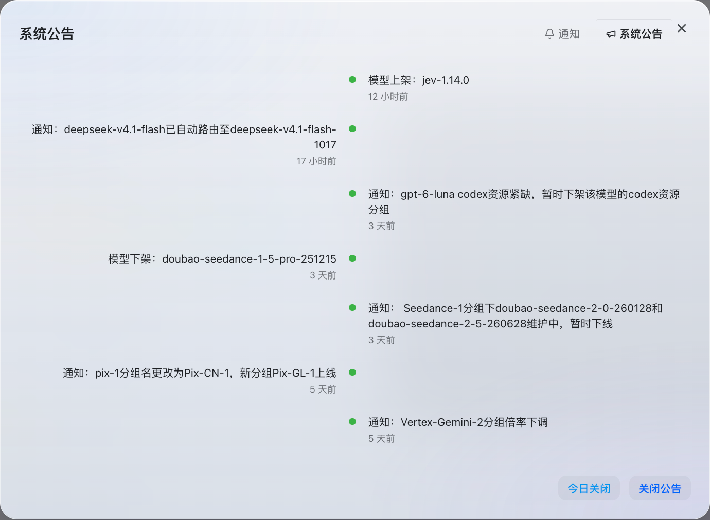
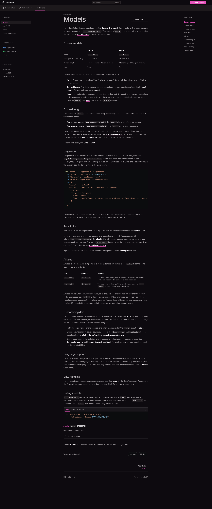
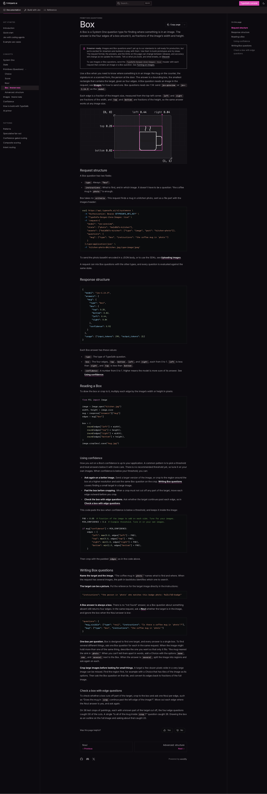
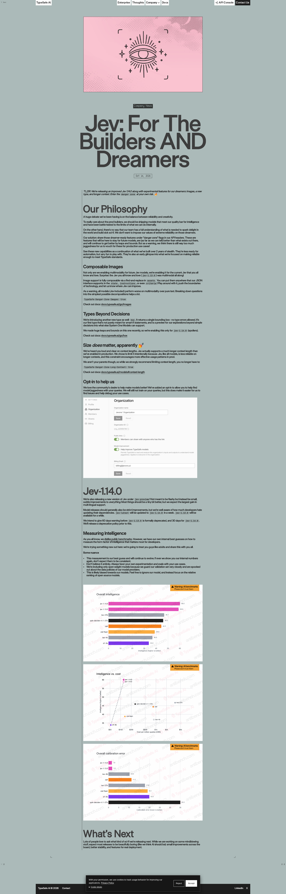

> 在线阅读（GitHub Pages）：https://maynor996.github.io/typesafe-jev-1-14-guide/

# TypeSafe Jev 1.14.0 使用教程：System One 决策 API 从入门到 box 定位

本教程面向要把 **TypeSafe Jev `jev-1.14.0`** 接到业务代码里的工程师：从申请/配置 API Key、发出第一个请求，到四种题型、多题并行、图片 + `box`、长上下文、置信度落地，再到排错。目标是一份**可照抄改写的动手指南**，不是产品软文。

先对齐心智模型：Jev 是 TypeSafe 的 **System One 决策模型**。你把业务上下文放进 `state`，再声明一组带类型的 `questions`；模型对同一份 `state` **并行**评估每道题，返回可分支、可阈值的结构化答案。它不陪聊、不追求长文生成——chat LLM 给你的是叙述，Jev 给你的是**可编程的 smart-if**。

**版本钉死建议：** 示例一律使用模型 ID **`jev-1.14.0`**。别名要小心：

| 别名 | 文档含义 | 实践建议 |
|------|----------|----------|
| `jev-preview` | 指向最新预览构建（发布窗口内对应 `jev-1.14.0`） | 可试新特性；阈值标定后请改钉版本号 |
| `jev-latest` | 指向「当前稳定」并会在发布后滚动 | **不要**当生产 SLA；响应里的 `model` 字段才是真实版本 |

官方博客（2026-10-14）写明：`jev-latest` 会在约一周后切到 1.14；在此前后，你的置信度阈值若钉在某一版上，请求里请直接写 `jev-1.14.0` 或 `jev-1.13.0`。



---

## 1. 从申请 Key 到请求骨架

### 1.1 拿 Key

1. 登录 TypeSafe 控制台，创建 API Key。
2. 只放服务端环境变量，不要写进前端或仓库：

```bash
export TYPESAFE_API_KEY="your-api-key"
```

3. 可选：用 `GET https://api.typesafe.ai/v1/models` 看账号可见的模型名与别名（版本号 ID 即使未出现在列表里，请求里通常仍可直接写）。

### 1.2 唯一决策端点

```http
POST https://api.typesafe.ai/v1/systemone
Authorization: Bearer <token>
Content-Type: application/json
```

危险区能力用**额外请求头**打开（按需、按请求）：

```http
TypeSafe-Danger-Zone-Images: true
TypeSafe-Danger-Zone-Long-Context: true
```

### 1.3 Body 字段

| 字段 | 必填 | 含义 |
|------|------|------|
| `model` | 是 | 模型 ID 或别名；本教程固定 `jev-1.14.0` |
| `state` | 是 | 被评估内容：字符串 / JSON 对象 / 数组 |
| `questions` | 是 | 命名问题字典；`answers` 用同名键回传 |
| `assets` | 否 | 图片占位符 → 图像（multipart 的 `part` 或 `data_base64`） |

### 1.4 价格与默认上下文（与 1.13 对齐）

| 项 | 值 |
|----|-----|
| 输入 | **$0.042 / M tokens**（文档亦写 $42 / B tokens） |
| 输出 | **免费** |
| 默认 per-request | **64k**（`state` + 全部问题合计） |
| 默认 per-question | **32k**（`state` + 任意单题） |
| 问题个数 | **无单独硬顶**，只要塞进上述两道限制 |

设计含义：鼓励「一次塞 state、一次扇出很多原子题」；限制主要在 token，不在题数。



---

## 2. 第一个请求：打通一条 noul

`noul` 回答「是否为真」：返回 `noul` ∈ **[0, 1]**。接近 1 偏是，接近 0 偏否，接近 0.5 表示不确定。**没有单独的 `confidence` 字段**——不确定度就在概率里；若要与 choice 同一套门禁，可用 `abs(2 * p - 1)` 映射到 0–1。

```bash
curl -sS https://api.typesafe.ai/v1/systemone \
  -H "Authorization: Bearer $TYPESAFE_API_KEY" \
  -H "Content-Type: application/json" \
  -d '{
    "model": "jev-1.14.0",
    "state": "I was charged twice for my subscription this month. Please refund the extra charge.",
    "questions": {
      "about_billing": {
        "type": "noul",
        "instructions": "Is this message about billing or charges?"
      }
    }
  }'
```

典型成功响应形状（数值会随版本微调）：

```json
{
  "model": "jev-1.14.0",
  "answers": {
    "about_billing": { "type": "noul", "noul": 0.98 }
  },
  "usage": { "input_tokens": 120, "output_tokens": 12 }
}
```

可选：用 `criteria` 澄清「什么算是 / 什么算否」，减少边界歧义：

```json
"about_billing": {
  "type": "noul",
  "instructions": "Is this message about billing or charges?",
  "criteria": {
    "true": "Mentions payment, invoice, refund, or subscription charge",
    "false": "Unrelated to money or billing"
  }
}
```

### Python SDK 草图

包名以官方文档为准（`typesafe-sdk`）。客户端默认读环境变量中的 Key：

```python
from typesafe_sdk import Noul, TypeSafeClient

state = "I was charged twice for my subscription this month. Please refund the extra charge."

with TypeSafeClient() as client:
    resp = client.system_one(
        model="jev-1.14.0",
        state=state,
        questions={
            "about_billing": Noul(
                instructions="Is this message about billing or charges?",
            ),
        },
    )

p = resp.answers["about_billing"].noul
print("noul=", p, "self_conf≈", abs(2 * p - 1))
```

写题习惯：**问题 ID 只给你代码用，不会当题面送给模型**；完整判断逻辑写在 `instructions` 里。`state` 若是对象，用反引号路径引用字段，例如 `` `ticket.body` ``。

---

## 3. 四种题型：怎么选、返回什么

| 类型 | 一句话 | 请求要点 | 返回字段 |
|------|--------|----------|----------|
| `noul` | 是否为真？ | `instructions`；可选 true/false criteria | `noul` |
| `choice` | 无序多选一 | **必填** `criteria`：选项名 → 说明 | `choice`、`probabilities`、`confidence` |
| `score` | 有序量尺上的位置 | **必填** `criteria`：有序等级数组（从 0） | `score`、`legend`、`probabilities`、`confidence` |
| `box` | **1.14 only** 图上定位 | 只要 `instructions`，**无 criteria**；需图像危险区头 | `box{left,top,right,bottom}`（0–1 分数）+ `confidence` |

选型口诀：

- 要进哪个队列 / 哪种意图 → **`choice`**（选项互斥、无序）。
- 要紧急度、严重度、满意度档位 → **`score`**（档位有序；`score` 可以是期望值，落在两档之间）。
- 要「能不能自动放行」「有没有退款请求」→ **`noul`**。
- 要「目标在图上的哪里」→ **`box`**，并**永远**再配一道存在性 `noul`。

写题原则（官方也反复强调）：**一道题只问一个「瞬间判断」**。「分析这条消息并给出处理方案」太宽——拆成原子题，在你的代码里加权组合。答案被约束在你给的选项/等级上，不会吐自由文本标签，这正是可上线的原因。

### 3.1 choice 最小例

```json
"tone": {
  "type": "choice",
  "instructions": "What is the tone of this message?",
  "criteria": {
    "angry": "Upset or hostile",
    "calm": "Neutral or polite",
    "excited": "Enthusiastic"
  }
}
```

### 3.2 score 最小例

```json
"urgency": {
  "type": "score",
  "instructions": "How urgent is this message?",
  "criteria": [
    "Can wait",
    "Needs attention this week",
    "Needs attention today"
  ]
}
```

`score` 是概率加权期望，可能是 `1.7` 这类小数；用 `legend` 把数字映射回你写的等级文案，用 `probabilities` 看各档分布。

### 3.3 box 特殊规则（务必记住）

1. 需要 `TypeSafe-Danger-Zone-Images: true`。
2. 模型必须是 **`jev-1.14.0`**（或当时指向它的 preview 别名）。
3. **总会返回一个框**——没有「未找到」。目标不在图上时，框可能落到无关区域；所以同请求加 `noul`，低概率时丢弃框。
4. 坐标相对图像宽高：`left < right`，`top < bottom`，原点左上。

---

## 3.4 写好 `state` 与 `instructions`

`state` 可以是纯字符串，也可以是结构化 JSON。结构化时，在题面里用反引号引用路径，模型才知道「判哪一块」：

```json
{
  "ticket": {
    "subject": "Duplicate charge",
    "messages": [
      {"from": "customer", "text": "I was charged twice for order A-104. Please refund."}
    ]
  },
  "order": {"id": "A-104", "charges": [{"amount_usd": 49}, {"amount_usd": 49}]},
  "refund_policy": "Duplicate charges are eligible for a refund."
}
```

对应题面示例：

```json
"refund_requested": {
  "type": "noul",
  "instructions": "Does `ticket.messages[0].text` request a refund?"
},
"policy_ok": {
  "type": "noul",
  "instructions": "Does `refund_policy` support the refund in `ticket.messages[0].text` given `order.charges`?"
}
```

常见坏写法与改法：

| 坏写法 | 为什么差 | 改法 |
|--------|----------|------|
| 「全面分析这张工单并给出处理建议」 | 不是瞬间判断，答案不可分支 | 拆成 queue / urgency / needs_human |
| 题 ID 叫 `is_refund` 但 instructions 很含糊 | ID 不参与推理 | 把条件写全进 instructions |
| 把整本知识库塞进每题 | 撞 per-question 32k，变慢变不准 | state 只留本案相关；知识库先检索再塞摘要 |
| 用 chat 式 system prompt 堆角色扮演 | System One 不是对话模型 | 用 criteria 定义边界，用代码组合答案 |

复杂判断用 **Composite scoring**：多道 `score`/`noul` 并行，权重写在你的代码里；优先级变了只改权重，不必重写一整段 prompt。

---

## 4. 多题并行实战：工单路由（noul + choice + score）

下面把三类题塞进**一次**请求：是否要人工升级、进哪个队列、紧急度多少。这是最常见的落地模板——同一 `state` 投机扇出，代码决定用哪几个答案。

```bash
curl -sS https://api.typesafe.ai/v1/systemone \
  -H "Authorization: Bearer $TYPESAFE_API_KEY" \
  -H "Content-Type: application/json" \
  -d '{
    "model": "jev-1.14.0",
    "state": {
      "ticket": {
        "subject": "API 500 on checkout",
        "body": "Checkout started returning 500 about 20 minutes ago. No orders can complete. Please escalate."
      },
      "sla": "P1 if revenue path is blocked."
    },
    "questions": {
      "needs_human": {
        "type": "noul",
        "instructions": "Does `ticket.body` require immediate human escalation given `sla`?"
      },
      "queue": {
        "type": "choice",
        "instructions": "Which queue should own `ticket`?",
        "criteria": {
          "billing": "Payment, invoice, or subscription charges",
          "technical": "Bugs, outages, or integration errors",
          "sales": "Pricing, plans, or account upgrades"
        }
      },
      "urgency": {
        "type": "score",
        "instructions": "How urgent is `ticket` for engineering?",
        "criteria": [
          "Can wait until next business day",
          "Needs attention this week",
          "Needs attention today / revenue blocked"
        ]
      }
    }
  }'
```

示例响应形状：

```json
{
  "model": "jev-1.14.0",
  "answers": {
    "needs_human": { "type": "noul", "noul": 0.93 },
    "queue": {
      "type": "choice",
      "choice": "technical",
      "confidence": 0.95,
      "probabilities": {
        "billing": 0.02,
        "technical": 0.96,
        "sales": 0.02
      }
    },
    "urgency": {
      "type": "score",
      "score": 1.8,
      "confidence": 0.7,
      "legend": {
        "0": "Can wait until next business day",
        "1": "Needs attention this week",
        "2": "Needs attention today / revenue blocked"
      },
      "probabilities": { "0": 0.05, "1": 0.1, "2": 0.85 }
    }
  },
  "usage": { "input_tokens": 380, "output_tokens": 60 }
}
```

### 同请求的 Python SDK 草图

```python
from typesafe_sdk import Choice, Noul, Score, TypeSafeClient

state = {
    "ticket": {
        "subject": "API 500 on checkout",
        "body": "Checkout started returning 500 about 20 minutes ago. No orders can complete.",
    },
    "sla": "P1 if revenue path is blocked.",
}

with TypeSafeClient() as client:
    resp = client.system_one(
        model="jev-1.14.0",
        state=state,
        questions={
            "needs_human": Noul(
                instructions="Does `ticket.body` require immediate human escalation given `sla`?",
            ),
            "queue": Choice(
                instructions="Which queue should own `ticket`?",
                criteria={
                    "billing": "Payment, invoice, or subscription charges",
                    "technical": "Bugs, outages, or integration errors",
                    "sales": "Pricing, plans, or account upgrades",
                },
            ),
            "urgency": Score(
                instructions="How urgent is `ticket` for engineering?",
                criteria=[
                    "Can wait until next business day",
                    "Needs attention this week",
                    "Needs attention today / revenue blocked",
                ],
            ),
        },
    )

print(resp.answers["needs_human"].noul)
print(resp.answers["queue"].choice, resp.answers["queue"].confidence)
print(resp.answers["urgency"].score, resp.answers["urgency"].confidence)
```

**性能直觉：** 官方 cookbook 用「13 题一批 vs 13 次单题」说明：批处理可显著更便宜、更快，且答案形态不变。习惯「一题一请求」的 agent/脚本，改成扇出后收益最大。

若某题依赖上一题的答案才能构造下一题的 `state`/选项（例如层级分类），才做第二次请求；否则优先同请求并行，在代码里忽略用不上的答案。

---

## 5. 图片 + box：multipart 与 noul 配对

图像与 `box` 属于 **danger zone**（官方称 dreamer-ready：欢迎原型探索，**接口形状与精度仍可能演进**，勿默认当生产真理）。每次含图或 `box` 的请求必须带：

```http
TypeSafe-Danger-Zone-Images: true
```

官方提醒：**多模态整体弱于纯文本**；复杂判断请拆题、写清目标。音频/视频不直接吃，需先转文本或结构化字段再进 `state`。图片可通过 `assets` 组合进 `state`、`instructions`、甚至 `criteria`（占位符 find-and-replace）。



### 5.1 multipart curl 草图（推荐）

第一部分名必须是 `request`（JSON）；每个图像 part 名与 `assets.*.part` 对齐：

```bash
curl -sS https://api.typesafe.ai/v1/systemone \
  -H "Authorization: Bearer $TYPESAFE_API_KEY" \
  -H "TypeSafe-Danger-Zone-Images: true" \
  -F 'request={
    "model": "jev-1.14.0",
    "state": {"photo": "asset-kitchen"},
    "assets": {
      "asset-kitchen": { "type": "image", "part": "kitchen-photo" }
    },
    "questions": {
      "mug_visible": {
        "type": "noul",
        "instructions": "Is there a coffee mug in `photo`?"
      },
      "mug": {
        "type": "box",
        "instructions": "the coffee mug in `photo`"
      }
    }
  };type=application/json' \
  -F 'kitchen-photo=@kitchen.jpg;type=image/jpeg'
```

期望 `answers.mug` 类似：

```json
{
  "type": "box",
  "box": { "top": 0.25, "bottom": 0.82, "left": 0.44, "right": 0.84 },
  "confidence": 0.92
}
```

### 5.2 应用侧：存在性门禁 + 像素裁剪

```python
VISIBLE_MIN = 0.70  # 用你自己的图标定

vis = answers["mug_visible"]["noul"]
box_ans = answers["mug"]

if vis < VISIBLE_MIN:
    result = {"found": False, "reason": "noul_below_threshold", "noul": vis}
else:
    edges = box_ans["box"]
    w, h = image.size  # PIL Image
    crop_box = (
        round(edges["left"] * w),
        round(edges["top"] * h),
        round(edges["right"] * w),
        round(edges["bottom"] * h),
    )
    # 低置信时外扩 padding，降低切掉目标的风险
    conf = box_ans.get("confidence")
    if conf is not None and conf < 0.6:
        pad = 0.05
        edges = {
            "left": max(0.0, edges["left"] - pad),
            "top": max(0.0, edges["top"] - pad),
            "right": min(1.0, edges["right"] + pad),
            "bottom": min(1.0, edges["bottom"] + pad),
        }
        crop_box = (
            round(edges["left"] * w),
            round(edges["top"] * h),
            round(edges["right"] * w),
            round(edges["bottom"] * h),
        )
    result = {"found": True, "crop": crop_box, "confidence": conf, "noul": vis}
```

小目标在超大图上容易丢：可先分区/`choice` 选瓦片，再对瓦片做 `box`，最后把分数坐标换算回全图。多个不同目标 → 多道 `box`；同种多个目标 → 在 instructions 里写清「哪一个」（例如 nearest the sink），或另加 `choice` 区分 none/one/several。

JSON + `data_base64` 适合小图调试；生产大图优先 multipart。请求体上限 **32 MiB**。

---

## 6. 长上下文危险区

默认 64k / 32k。需要合同时、长转录等场景时：

```http
TypeSafe-Danger-Zone-Long-Context: true
```

两端抬到 **262k**。单价不变，但官方写得很直白：**更慢、更不准**。优先裁剪 `state`、拆请求；长上下文是逃生舱，不是默认模式。

```bash
curl -sS https://api.typesafe.ai/v1/systemone \
  -H "Authorization: Bearer $TYPESAFE_API_KEY" \
  -H "Content-Type: application/json" \
  -H "TypeSafe-Danger-Zone-Long-Context: true" \
  -d '{
    "model": "jev-1.14.0",
    "state": "<long contract or transcript text>",
    "questions": {
      "has_termination": {
        "type": "noul",
        "instructions": "Does the state include a clause that lets either party end the agreement early?"
      }
    }
  }'
```

超限常见表现是 `400`（含上下文相关错误码一类）；先减 `state` 或开长上下文头，再查组织限流。

---

## 7. 置信度落地：阈值写在应用里

| 题型 | 「不确定」怎么读 |
|------|------------------|
| `noul` | 看 `noul`；≈0.5 最不确定。可选 `abs(2*p-1)` |
| `choice` / `score` | 用返回的 `confidence`（由 `probabilities` 导出）；也可自用 `p_max` 或 top/second 比 |
| `box` | 有 `confidence`（偶发 null）；低则 padding / 换图 / 依赖配对 `noul` |

**没有官方万能阈值。** 按风险在自己样本上标定：只读展示可放宽；退款、删改、自动外呼等抬高。

三档行为模板：

1. **高置信** → 自动执行  
2. **中置信** → 自动但打标抽检 / 二次确认  
3. **低置信** → 人工或拒动  

```python
def route_ticket(answers, *, noul_hi=0.85, choice_hi=0.80, choice_lo=0.50):
    needs = answers["needs_human"]["noul"]
    queue = answers["queue"]
    urg = answers["urgency"]
    noul_conf = abs(2 * needs - 1)

    if noul_conf < 0.30 or queue["confidence"] < choice_lo:
        return {"action": "human_review", "reason": "low_confidence"}

    if needs >= noul_hi and queue["confidence"] >= choice_hi:
        return {
            "action": "auto_escalate",
            "queue": queue["choice"],
            "urgency": urg["score"],
        }

    # 中置信：可分队列，但进审计队列
    return {
        "action": "auto_route_with_audit",
        "queue": queue["choice"],
        "urgency": urg["score"],
        "queue_confidence": queue["confidence"],
        "urgency_confidence": urg["confidence"],
    }


def gate_destructive(choice_answer, *, min_conf=0.90):
    """高风险动作：阈值抬高。"""
    if choice_answer["confidence"] < min_conf:
        return "confirm_with_user"
    return "execute"
```

把阈值、模型版本、采样集版本写进配置与评测报告；换 `jev-1.14.0` ←→ `jev-1.13.0` 时重新跑回归，不要假设别名滚动后阈值仍成立。

---

## 8. 排错

| 现象 | 常见原因 | 处理 |
|------|----------|------|
| `400` / **`api_usage_error`**（尤其 box） | 在 **`jev-1.13.0`** 上使用了 `type: "box"`；或未开图像头却带了图像/`box` | `model` 改为 **`jev-1.14.0`**；加 `TypeSafe-Danger-Zone-Images: true` |
| `401` | Key 缺失/错误 | 检查 `Authorization: Bearer …` |
| `422` | 缺字段、schema 错（如 `choice`/`score` 无 `criteria`） | 对照 System One OpenAPI 改题面 |
| `429` | 组织 tokens/s 或 requests/s 超限 | 指数退避；官方 SDK 默认重试并尊重 `retry-after`；直连 HTTP 请自写 |
| `413` | 体 > 32 MiB | 缩小图/压缩；可单层 `Content-Encoding: gzip` |
| `529` | 服务过载 | 短延迟后重试 |
| 多模态差 | 官方：图文弱于纯文本 | 拆题、写清目标、大图分区再 `box`；存在性用 `noul` |
| 答案「飘」 | 滚动别名或 state 过脏/过长 | pin `jev-1.14.0`；清洗 state；非必要勿开长上下文 |
| 语言效果不稳 | 英文为主训；CJK 等需自测 | 1.14 官方称多语言有改进，仍用你的样本标定 |

### 8.1 联调顺序建议

1. 先用纯文本 `noul` 打通鉴权与计费字段（看 `usage.input_tokens`）。  
2. 再加 `choice`/`score`，把阈值打日志但不自动执行。  
3. 用历史工单离线回放，画置信度分布，再定自动/人工分界。  
4. 最后才开图像头与 `box`，并且用「noul 门禁 + 人工抽检框」双保险。  
5. 长上下文头单独开关：默认关闭，压测通过后再对白名单流量开启。

### 8.2 与 1.13 并存时

一段时间内 `jev-1.13.0` 仍可用。文本三题型（noul/choice/score）两边都能跑；**只有 `box` 绑定 1.14**。迁移时：

- 新代码路径 pin `jev-1.14.0`；旧路径可暂留 1.13。  
- 不要假设同一题面在两版上的 `confidence` 分布完全一致——换版重标定。  
- 官方计划在正式弃用前给出窗口提示（博客口径：1.13 约 60 天预警量级，具体以官方后续政策为准）。

---



---

## 9. 上线前检查清单

1. 生产请求写死 **`"model": "jev-1.14.0"`**，日志记录响应 `model` 与 `usage`。  
2. 题面原子化；同 `state` 尽量一批并行问完（投机扇出）。  
3. `choice`/`score` 用 `confidence` 分自动 / 抽检 / 人工；`noul` 用概率本身。  
4. `box` 必配对 `noul`；图像头、模型版本写入集成测试。  
5. 用真实工单与图片标定阈值后再调重试与限流策略。  
6. 危险区（图像、长上下文、`box`）与稳定决策路径分轨：原型可以玩，生产要单独压测。

---

## 参考链接（官方）

- 发布说明：https://typesafe.ai/blog/jev-1-14  
- Models / 上下文：https://docs.typesafe.ai/models  
- System One API：https://docs.typesafe.ai/api/system-one  
- Primitives 总览：https://docs.typesafe.ai/primitives  
- Choice：https://docs.typesafe.ai/primitives/choice  
- Box：https://docs.typesafe.ai/primitives/box  

（Score、Noul、Confidence、Images 等同域文档可从 Primitives / Models 页继续跳转。）按本文从 Key → 首请求 → 四题型 → 并行路由 → 图文 box → 长上下文 → 置信度 → 排错走通一遍后，你就有把 Jev 嵌进路由与门禁流水线的完整骨架。